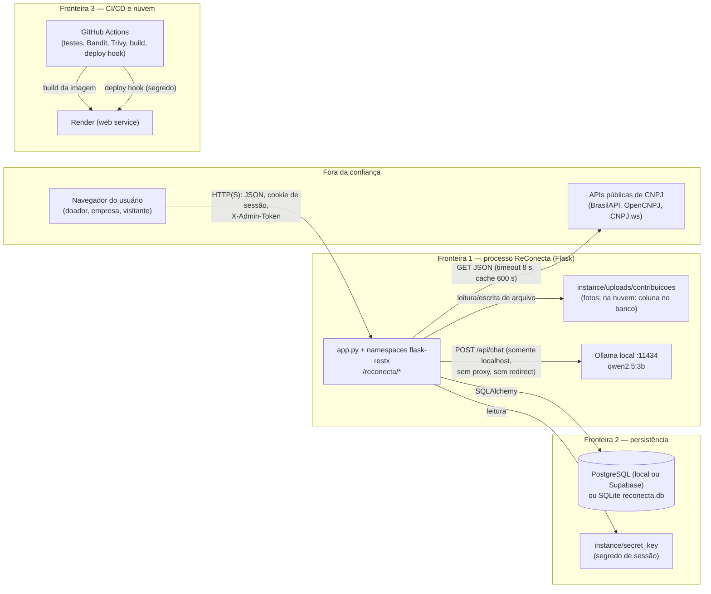

# Matriz de riscos STRIDE — ReConecta

Data da análise: 2026-10-13 · Base: `main` em `e652512` · Escopo: sistema **como ele é hoje**
(local Flask + SQLite/PostgreSQL + Ollama local), com observações para o estado em nuvem
(Render + Supabase + GitHub Actions) que a rodada 10 prepara.

Método: leitura do código-fonte (`app.py`, `Auth.py`, `Cadastro.py`, `cnpj_service.py`,
`Publico.py`, `Contribuicoes.py`, `Painel.py`, `Dashboard.py`, `IA.py`, `llm_service.py`,
`crud_admin.py`, `crud_validacao.py`, `models.py`, `migracoes.py`, `static/js/*`,
`schema.sql`, `docs/*`) e dos relatórios SAST em `relatorios/sast/`. Controles citados
existem no código (`arquivo:linha`); o que não existe aparece como **lacuna**.

## 1. Diagrama de fluxo de dados

**Fronteiras de confiança**

| # | Fronteira | O que a cruza | Risco típico |
|---|---|---|---|
| 1 | Navegador → API Flask | Credenciais, CPF/CNPJ, formulários, foto, cookie de sessão, X-Admin-Token | Entrada maliciosa, roubo de sessão, abuso de endpoints públicos |
| 2 | API → banco e sistema de arquivos | Consultas SQL, bytes de foto, segredo de sessão | Injeção, path traversal, vazamento de PII |
| 3 | API → APIs de CNPJ | Número de CNPJ; resposta JSON externa | Resposta comprometida/enganosa, indisponibilidade |
| 4 | API → Ollama | Texto do pedido (com PII removida), agregados do dashboard | Prompt injection, saída malformada, exfiltração |
| 5 | GitHub → Render/Supabase | Código, imagem Docker, DATABASE_URL, tokens | Segredo vazado, build adulterado, dependência comprometida |

## 2. Ativos e atores

**Ativos**

| Ativo | Onde vive | Sensibilidade |
|---|---|---|
| Credenciais (senha hash, cookie de sessão) | `estabelecimentos.senha_hash`, `doadores.senha_hash`, cookie assinado | Alta |
| CPF, e-mail, telefone, endereço | tabelas `doadores`, `estabelecimentos`, `instituicoes` | Alta (LGPD) |
| Fotos de contribuições | `instance/uploads/contribuicoes/` (futuro: coluna no banco) | Média (privadas por regra de acesso) |
| Pedidos, itens, contribuições | `doacoes`, `itens_doacao`, `contribuicoes`, `reservas` | Média (integridade do negócio) |
| `SECRET_KEY`, `ADMIN_TOKEN`, `DATABASE_URL`, deploy hook | `.env`, `instance/secret_key`, secrets do GitHub | Alta |
| Respostas das APIs de CNPJ | cache em memória (`cnpj_service._cache`) | Média (decidem o cadastro) |
| Saída da LLM | resposta de `/api/chat` | Média (vira sugestão na UI) |

**Atores**

| Ator | Acesso |
|---|---|
| Visitante anônimo | Páginas públicas, `/reconecta/publico/*`, `/reconecta/dashboard`, `/reconecta/cadastro/*`, `/reconecta/auth/login`, leitura dos CRUDs CP1, `/swagger` |
| Doador autenticado (pessoa física) | + contribuir em pedidos, `/reconecta/painel/minhas-doacoes`, `/reconecta/auth/me` |
| Empresa autenticada | + publicar/excluir seus pedidos, ver contribuições recebidas, `/reconecta/ia/interpretar-pedido` |
| Administrador (X-Admin-Token) | Escrita nos CRUDs CP1 (`estabelecimentos`, `instituicoes`, `doacoes`) e leitura completa (e-mail/telefone) |
| Operador do pipeline | Repositório no GitHub, secrets, deploy hook do Render |
| LLM local (Ollama) | Processa texto do pedido e agregados; não tem acesso ao banco |

## 3. Escala

Probabilidade (P) e Impacto (I) de 1 a 3 (1=baixo, 2=médio, 3=alto). Risco = P×I (1–9).
Risco residual = risco após os controles existentes.

## 4. Matriz STRIDE

### S — Falsificação de identidade (Spoofing)

| ID | Componente/fluxo | Ameaça | P | I | R | Controle existente | Residual | Ação recomendada |
|---|---|---|---|---|---|---|---|---|
| S1 | `POST /reconecta/auth/login` | Força bruta/credential stuffing de e-mail, CNPJ ou CPF | 3 | 3 | 9 | Hash Werkzeug (`Cadastro.py:205,255`), bloqueio de 5 falhas/15 min por identificador (`Auth.py:21-24,129-142`), 429 com Retry implícito | 4 | Limitar também por IP (hoje trocar o identificador contorna); o bloqueio em memória zera a cada restart e se divide entre workers do gunicorn |
| S2 | `POST /reconecta/cadastro/empresa` | Cadastrar-se com CNPJ **de terceiro**: a checagem usa só dados públicos da Receita, sem prova de posse | 2 | 3 | 6 | Validação de dígitos + situação ativa + CNAE alimentar (`Cadastro.py:176,192-198`; `cnpj_service.py:148-179`) | 4 | **Lacuna.** Verificação de e-mail com link/token, ou aprovação manual antes de publicar pedidos |
| S3 | `POST /reconecta/cadastro/doador` | Cadastro com CPF de terceiro: só dígitos verificadores são checados | 2 | 2 | 4 | DV do CPF (`Cadastro.py:105-116`), unicidade (`Cadastro.py:250`) | 4 | **Lacuna.** Verificação de e-mail; sem ela, qualquer e-mail também é aceito como identidade |
| S4 | Cookie de sessão | Roubo de cookie em trânsito (Secure ausente) ou cross-site | 2 | 3 | 6 | `HttpOnly` + `SameSite=Lax` (`Auth.py:65-66`), sessão regenerada no login (`Auth.py:69-73`) | 4 | **Lacuna parcial.** `SESSION_COOKIE_SECURE` atrás de HTTPS (Frente A prevê `COOKIE_SEGURO=1`) |
| S5 | CRUDs CP1 (`/reconecta/estabelecimentos` etc.) | Uso de `X-Admin-Token` vazado/advinhado | 2 | 3 | 6 | Comparação em tempo constante `hmac.compare_digest` e fail-closed sem token configurado (`crud_admin.py:9-23`) | 3 | **Lacuna.** Token único e estático, sem rotação nem trilha; considerar papéis e log de uso |

### T — Adulteração de dados (Tampering)

| ID | Componente/fluxo | Ameaça | P | I | R | Controle existente | Residual | Ação recomendada |
|---|---|---|---|---|---|---|---|---|
| T1 | Todos os endpoints com SQL | Injeção SQL via corpo/filtros | 2 | 3 | 6 | SQLAlchemy ORM parametrizado em todo o código; `LIKE` de usuário com escape (`Publico.py:150-153`); constraints CHECK/FK no banco (`models.py:48-54,70-74,104-118`) | 2 | Manter ORM; os `text()` de `migracoes.py` só recebem identificadores internos (ver relatório Bandit) |
| T2 | `POST .../contribuicoes` (foto) | Upload de arquivo malicioso (executável, polyglot, path traversal) | 2 | 3 | 6 | Assinatura JPEG/PNG/WebP (`Contribuicoes.py:34-41`), teto 5 MB (`:19,134-141`), nome gerado no servidor (`:155`), gravação exclusiva `xb` (`:160`), regex de nome + `nosniff` na leitura (`:193-201`), pasta fora de `static/` | 2 | Validar também a imagem decodificando-a (ex.: Pillow gratuito) para barrar polyglots |
| T3 | `POST .../contribuicoes` (campos) | Forjar item/quantidade/categoria/validade fora do pedido | 2 | 2 | 4 | Item precisa pertencer ao pedido (`Contribuicoes.py:107-111`), `Decimal` com 2 casas (`:44-57`), questionário alimentar obrigatório (`:122-153`), empresa não doa para o próprio pedido (`:95-96`) | 1 | — |
| T4 | Saída da LLM → formulário | Prompt injection que injeta itens/preços falsos | 2 | 2 | 4 | Saída validada contra esquema (`llm_service.py:164-187`), conferida com parser de regras (`:246-270`), só pré-preenche — a empresa revisa e o POST revalida (`IA.py:52-68`, `Painel.py:67-97`) | 1 | — |
| T5 | `PUT`/`DELETE` dos CRUDs CP1 | Admin altera status/vínculos sem rastro | 2 | 2 | 4 | Status restrito a enum (`crud_validacao.py:95-98`; `models.py:50-51`), delete bloqueado com dependentes (`Doacoes.py:134-138`, `Estabelecimentos.py:156-159`) | 2 | **Lacuna.** Sem trilha de auditoria de quem alterou o quê (ver R2) |
| T6 | `requirements.txt` / pipeline | Dependência adulterada (supply chain) | 2 | 3 | 6 | Versões fixadas para a maioria; Trivy em CI (Frente A) | 4 | **Lacuna.** `psycopg[binary]>=3.2`, `SQLAlchemy>=2.1`, `tzdata>=2024.1` são faixas abertas; fixar e habilitar pip-audit/Trivy na rotina (`scripts/sast.py`) |

### R — Repúdio (Repudiation)

| ID | Componente/fluxo | Ameaça | P | I | R | Controle existente | Residual | Ação recomendada |
|---|---|---|---|---|---|---|---|---|
| R1 | Contribuições e pedidos | Usuário nega autoria de uma doação/pedido | 2 | 2 | 4 | `doador_id`/`estabelecimento_id` + `criado_em` (`models.py:119-132`, `:55-61`) identificam autor e data | 2 | Parcial: sem trilha de eventos, só o estado final fica registrado |
| R2 | Operações admin (CRUDs CP1) | Uso do token admin sem responsabilização | 2 | 2 | 4 | Nenhum log de quem usou o token | 4 | **Lacuna.** Logar método, rota, resultado e hash do token em `app.logger` ou tabela de auditoria |
| R3 | Login, cadastro, troca de senha, exclusões | Impossível reconstruir incidente | 3 | 2 | 6 | Só exceções 500 vão ao log (`app.py:95-104`, `Contribuicoes.py:175`, `Painel.py:140`) | 5 | **Lacuna.** Log de segurança (sucesso/falha de login, cadastro, alterações, upload) com timestamp e ator |
| R4 | Respostas das APIs de CNPJ | Fonte externa responde dado errado e empresa inapta é cadastrada | 2 | 2 | 4 | 3 fontes com fallback e normalização (`cnpj_service.py:141-179`), mas a **primeira** que responde vence | 3 | Registrar `fonte` (já retornado em `Cadastro.py:57`) em log; considerar conferência cruzada quando divergente |

### I — Divulgação de informação (Information Disclosure)

| ID | Componente/fluxo | Ameaça | P | I | R | Controle existente | Residual | Ação recomendada |
|---|---|---|---|---|---|---|---|---|
| I1 | `GET /reconecta/auth/me`, cadastro | Vazamento de CPF | 2 | 3 | 6 | CPF sempre mascarado `***.XXX.XXX-**` (`Auth.py:98`, `Cadastro.py:266`) | 1 | — |
| I2 | `GET` público de estabelecimentos/instituições | Vazamento de e-mail/telefone | 2 | 3 | 6 | Sem token: resposta sem e-mail/telefone e CNPJ sem máscara (`Estabelecimentos.py:26-33`, `Instituicoes.py:26-33`) | 2 | Endereço completo segue público (decisão de produto; revisar se for excesso) |
| I3 | `GET .../contribuicoes/<id>/foto` | Foto privada acessível a terceiros | 2 | 3 | 6 | Autorização por participante (`Contribuicoes.py:185-194`), 404 genérico, `Cache-Control: private, no-store` (`:201`) | 1 | — |
| I4 | Prompts à LLM | PII ou dados internos enviados ao modelo | 2 | 3 | 6 | Regex remove e-mail/documento/telefone (`llm_service.py:53-59`), resumo usa só agregados (`:307-330`), Ollama restrito a localhost sem proxy/redirect (`:62-73,88,97`) | 1 | — |
| I5 | Erros e stack traces | Detalhe interno na resposta | 2 | 2 | 4 | `ERROR_INCLUDE_MESSAGE=False` (`app.py:17`), 500 genérico (`app.py:91-104`), códigos de erro padronizados | 1 | — |
| I6 | Segredos no repositório | `.env`, `SECRET_KEY`, `DATABASE_URL` commitados | 2 | 3 | 6 | `.env` e `instance/` no `.gitignore`; chave local em `instance/secret_key` fora do VCS (`Auth.py:49-64`); Trivy `secret` scanner não achou nada | 2 | Manter Trivy `secret` em CI; Frente A adiciona `SECRET_KEY` gerada no Render |
| I7 | Resposta pública `/publico/*`, `/dashboard` | Enumeração/scraping de dados agregados e de empresas | 2 | 1 | 2 | Paginação limitada a 100/página (`Publico.py:92-96`), validação de filtros (`:129-140`) | 2 | Aceito para MVP; rate limit global mitigaria scraping |
| I8 | `/swagger` e `swagger.json` | Documentação da API pública facilita mapeamento | 2 | 1 | 2 | — (decisão: API pública documentada) | 2 | Aceito |

### D — Negação de serviço (Denial of Service)

| ID | Componente/fluxo | Ameaça | P | I | R | Controle existente | Residual | Ação recomendada |
|---|---|---|---|---|---|---|---|---|
| D1 | `POST /reconecta/auth/login` | Lockout malicioso: errar a senha de propósito trava a conta da vítima por 15 min | 2 | 1 | 2 | Bloqueio por identificador (`Auth.py:129-142`) | 2 | Aceitar como trade-off ou exigir CAPTCHA/verificação em vez de bloqueio puro |
| D2 | `POST /reconecta/ia/interpretar-pedido` | Empresa autenticada dispara chamadas ao Ollama (até 90 s cada) e esgota CPU/RAM do host | 2 | 2 | 4 | Exige login de empresa (`IA.py:57-62`), texto ≤600 caracteres (`:65-67`), timeout (2,90) (`llm_service.py:97`) | 4 | **Lacuna.** Não há rate limit neste endpoint (só `/resumo-dashboard` tem, `IA.py:29-49`); aplicar o mesmo `_permitir` por usuário |
| D3 | Upload de fotos | Volume ilimitado de contribuições enche o disco | 2 | 2 | 4 | `MAX_CONTENT_LENGTH` 6 MB (`app.py:16`), 5 MB/foto (`Contribuicoes.py:19`) | 4 | **Lacuna.** Sem cota por usuário nem limite global; na nuvem a foto vai para o banco (Frente A), o que troca disco por linhas — cotas continuam valendo |
| D4 | `GET /reconecta/cadastro/cnpj/<cnpj>` e cadastro | Abuso gera fan-out para 3 APIs externas | 2 | 1 | 2 | Cache 600 s por CNPJ (`cnpj_service.py:11,153-179`), timeout 8 s (`:10,163`), CNPJ precisa ser válido | 1 | Rate limit global cobriria |
| D5 | Qualquer endpoint | Flood genérico / slow-loris | 2 | 2 | 4 | Nenhum controle em nível de app; em produção ficará atrás do gunicorn (Frente A) | 4 | **Lacuna.** Sem limite global de requisições; gunicorn com workers/timeout + rate limit por IP (ou CDN/edge do Render) |
| D6 | Estruturas em memória (`_falhas`, `_acessos`, `_cache` CNPJ) | Crescimento por chaves distintas em processo longo | 1 | 2 | 2 | `_acessos` poda acima de 2048 entradas (`IA.py:39-42`); `_falhas` e `_cache` não têm teto | 2 | Podar `_falhas`/`_cache` como em `IA.py:39-42` |

### E — Elevação de privilégio (Elevation of Privilege)

| ID | Componente/fluxo | Ameaça | P | I | R | Controle existente | Residual | Ação recomendada |
|---|---|---|---|---|---|---|---|---|
| E1 | Sessão (cookie assinado) | Sequestro de sessão → conta inteira | 2 | 3 | 6 | `HttpOnly`, `SameSite=Lax` (`Auth.py:65-66`), `session.clear()` + nonce novo no login (`:69-73`), `usuario_id` validado como `int` e carregado do banco (`:76-87`), troca de senha exige a atual (`:238-242`) | 4 | `SESSION_COOKIE_SECURE` (Frente A); considerar `PERMANENT_SESSION_LIFETIME` curto |
| E2 | Endpoints com dono (IDOR) | Acessar/alterar recurso de outro usuário | 2 | 3 | 6 | Filtro por `estabelecimento_id=empresa.id` (`Painel.py:152`), checagem de participante na foto (`Contribuicoes.py:190-193`), `tipo` conferido (`Painel.py:44-46`, `IA.py:60-62`), campos permitidos em allowlist (`Auth.py:223-227`) | 1 | — |
| E3 | XSS armazenado/refletido | Script em nome de empresa/item rouba sessão | 2 | 3 | 6 | API é JSON; front renderiza dados com `textContent`/`createTextNode` (`layout.js:46-57`); `innerHTML` só com SVG constante (`layout.js:50,63`, `cadastro.js:37`, `painel.js:65,502`, `home.js:250`, `entrar.js:115`, `doacao.js:87`) | 3 | **Lacuna.** Sem CSP nem outros security headers; adicionar `Content-Security-Policy`, `X-Frame-Options`/`frame-ancestors`, `Referrer-Policy` |
| E4 | `X-Admin-Token` | Vazamento dá escrita total nos CRUDs CP1 | 2 | 3 | 6 | Fail-closed sem token (`crud_admin.py:16-19`), `compare_digest` (`:12-13`) | 3 | Token por operador + rotação + log (ver S5/R2); idealmente eliminar CRUD legado ou colocar atrás de login admin |
| E5 | `app.run` de desenvolvimento | Debug habilitado por engano expõe console Werkzeug | 1 | 3 | 3 | `debug` só com `FLASK_DEBUG=1` explícito (`app.py:133`) | 1 | Produção usará gunicorn (Frente A); manter `.env.example` com `FLASK_DEBUG=0` |
| E6 | Prompt injection → privilégio | Texto do pedido faz a LLM executar algo além de extrair itens | 1 | 2 | 2 | Modelo não tem ferramentas nem acesso ao banco; saída é JSON validado que só pré-preenche formulário (`llm_service.py:298-304`) | 1 | — |

## 5. Lacunas prioritárias (top 5)

| # | Lacuna | Ameaças | Ação sugerida | Dono natural |
|---|---|---|---|---|
| 1 | **Sem trilha de auditoria** — logins, cadastros, contribuições e usos do token admin não são registrados | R1–R4, E4 | Log de segurança estruturado (ator, ação, resultado, data) via `app.logger` ou tabela `auditoria` | Regente encaminha |
| 2 | **Cookie sem `Secure` e sem security headers** (CSP, X-Frame-Options, Referrer-Policy) | S4, E1, E3 | Frente A já liga `SESSION_COOKIE_SECURE` por `COOKIE_SEGURO=1`; adicionar `after_request` com os demais cabeçalhos | Frente A |
| 3 | **Cadastro sem prova de posse** — CNPJ/CPF/e-mail de terceiro são aceitos | S2, S3 | Verificação de e-mail (link com token) ou aprovação manual da empresa | Regente encaminha |
| 4 | **Rate limit ausente em `/ia/interpretar-pedido`, sem cota de upload e sem limite global** — e lockout que pode travar a vítima | D1–D5 | Reusar `_permitir_resumo` por usuário; cota de uploads; limite global por IP | Regente encaminha |
| 5 | **Dependências com faixas abertas + 4 CVEs médias** (`Werkzeug 3.1.8→3.1.9`, `requests→2.33.0`, `python-dotenv→1.2.2`, `pytest→9.0.3`; `psycopg`, `SQLAlchemy`, `tzdata` sem pin) | T6 | Fixar versões e atualizar para as corrigidas; ver `docs/sast.md` | Regente/Frente A (`requirements*.txt`) |

## 6. Observações para o estado em nuvem (rodada 10)

- `DATABASE_URL` na Supabase exige TLS — a Frente A normaliza `sslmode=require` para host
  remoto; sem isso, credenciais e dados trafegariam em claro (cobre S4/I6 no novo contexto).
- Foto da contribuição passa a morar no banco (disco efêmero do Render): as mesmas regras
  de acesso de `Contribuicoes.py:185-202` precisam ser preservadas na nova rota.
- GitHub Actions: `secrets.RENDER_DEPLOY_HOOK_URL` e `ADMIN_TOKEN`/`DATABASE_URL` devem
  ficar em secrets, com `permissions` mínimas nas actions fixadas por versão (Frente A).
- Estruturas de limite em memória (`_falhas`, `_acessos`, `_cache`) zeram a cada restart e
  se dividem entre workers do gunicorn — suficiente para o MVP, documentar se houver
  multi-instância.
