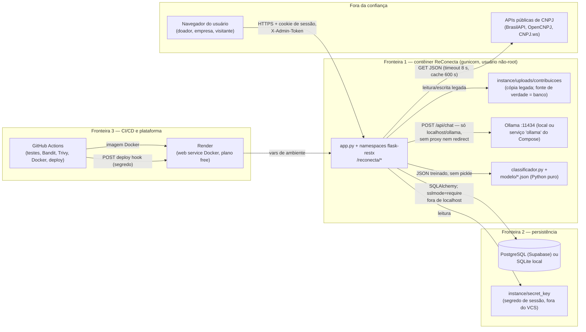

# Matriz de riscos STRIDE — ReConecta

- **1ª passada:** 2026-10-13, base `e652512` (pré-nuvem). Achados originais preservados na
  coluna "Estado" e na seção 7.
- **2ª passada:** 2026-10-13, base `main` `3a7939e` (Frentes A e C integradas: nuvem,
  Docker, CI/CD, dataset+classificador). Todas as referências `arquivo:linha` apontam para
  o código atual.

Método: leitura do código (`app.py`, `Auth.py`, `Cadastro.py`, `cnpj_service.py`,
`Publico.py`, `Contribuicoes.py`, `Painel.py`, `Dashboard.py`, `IA.py`, `llm_service.py`,
`classificador.py`, `crud_admin.py`, `crud_validacao.py`, `models.py`, `migracoes.py`,
`static/js/*`, `Dockerfile`, `docker-compose.yml`, `render.yaml`, `.github/workflows/ci.yml`,
`schema.sql`, `docs/*`) e dos relatórios SAST em `relatorios/sast/`. Controle só é citado
quando existe no código; o que não existe aparece como lacuna.

**Legenda de estado:** ✔ resolvida · ◐ parcial · ○ residual/aberta (ficou como estava).

## 1. Diagrama de fluxo de dados

**Fronteiras de confiança**

| # | Fronteira | O que a cruza | Risco típico |
|---|---|---|---|
| 1 | Navegador → API Flask | Credenciais, CPF/CNPJ, formulários, foto, cookie, X-Admin-Token | Entrada maliciosa, roubo de sessão, abuso de endpoints públicos |
| 2 | API → banco/disco | SQL, bytes de foto (coluna `foto_dados`), segredo de sessão | Injeção, path traversal, vazamento de PII |
| 3 | API → APIs de CNPJ | Número de CNPJ; resposta JSON externa | Resposta enganosa, indisponibilidade |
| 4 | API → Ollama | Texto do pedido (PII removida), agregados do dashboard | Prompt injection, saída malformada, exfiltração |
| 5 | GitHub → Render/Supabase | Código, imagem, `DATABASE_URL`, deploy hook, `SECRET_KEY` | Segredo vazado, build adulterado, dependência comprometida |

## 2. Ativos e atores

**Ativos**

| Ativo | Onde vive | Sensibilidade |
|---|---|---|
| Credenciais (senha hash, cookie de sessão) | `*.senha_hash`, cookie assinado | Alta |
| CPF, e-mail, telefone, endereço | `doadores`, `estabelecimentos`, `instituicoes` | Alta (LGPD) |
| Fotos de contribuições | coluna `contribuicoes.foto_dados` (`models.py:131`) + cópia em `instance/uploads/` | Média |
| Pedidos, itens, contribuições | `doacoes`, `itens_doacao`, `contribuicoes`, `reservas` | Média |
| `SECRET_KEY`, `ADMIN_TOKEN`, `DATABASE_URL`, `RENDER_DEPLOY_HOOK_URL` | `.env`, `instance/secret_key`, envVars do Render (`render.yaml:9-16`), secrets do GitHub | Alta |
| Modelo treinado | `modelo/classificador_categorias.json` (JSON, sem pickle) | Baixa |
| Respostas das APIs de CNPJ | cache em memória (`cnpj_service._cache`) | Média |
| Saída da LLM | resposta de `/api/chat` | Média |

**Atores**

| Ator | Acesso |
|---|---|
| Visitante anônimo | Páginas públicas, `/reconecta/publico/*`, `/reconecta/dashboard`, `/reconecta/saude`, `/reconecta/cadastro/*`, `/reconecta/auth/login`, leitura dos CRUDs CP1, `/swagger` |
| Doador autenticado | + contribuir (20/h por usuário), `/reconecta/painel/minhas-doacoes`, `/reconecta/auth/me` |
| Empresa autenticada | + publicar/excluir seus pedidos, contribuições recebidas, `/reconecta/ia/interpretar-pedido` (10/min) |
| Administrador (X-Admin-Token) | Escrita nos CRUDs CP1 e leitura completa (e-mail/telefone); cada uso é auditado |
| Operador do pipeline | Repositório GitHub, secrets, deploy hook do Render |
| LLM local (Ollama) | Processa texto/agregados; sem acesso ao banco; fora do deploy Render (sem GPU/memória) |

## 3. Escala

Probabilidade (P) e Impacto (I) de 1 a 3. Risco = P×I (1–9). Residual = após os controles
**atuais**.

## 4. Matriz STRIDE (referências atualizadas para `3a7939e`)

### S — Falsificação de identidade

| ID | Componente/fluxo | Ameaça | P | I | R | Controle existente | Residual | Estado / ação |
|---|---|---|---|---|---|---|---|---|
| S1 | `POST /reconecta/auth/login` | Força bruta/credential stuffing | 3 | 3 | 9 | Hash Werkzeug (`Cadastro.py:205,255`), bloqueio 5 falhas/15 min por identificador (`Auth.py:42-45,150-163`), auditoria de cada tentativa (`Auth.py:189-204`) | 3 | ◐ Falta limite por IP e o mapa `_falhas` é por processo (divide entre os 2 workers do gunicorn e zera a cada restart) |
| S2 | `POST /reconecta/cadastro/empresa` | Cadastro com CNPJ **de terceiro** (só dados públicos da Receita) | 2 | 3 | 6 | Dígitos + situação ativa + CNAE alimentar (`Cadastro.py:176,192-198`; `cnpj_service.py:148-179`); cadastro auditado (`Cadastro.py:216`) | 4 | ○ Prova de posse pendente (verificação de e-mail ou aprovação manual) |
| S3 | `POST /reconecta/cadastro/doador` | Cadastro com CPF/e-mail de terceiro | 2 | 2 | 4 | DV do CPF (`Cadastro.py:105-116`), unicidade (`:251`); auditoria (`:266`) | 4 | ○ Idem S2 |
| S4 | Cookie de sessão | Roubo de cookie em trânsito ou cross-site | 2 | 3 | 6 | `HttpOnly`+`SameSite=Lax` (`Auth.py:86-87`); **com `COOKIE_SEGURO=1`: `Secure` + `ProxyFix` + HSTS (`app.py:38-40,62-63`)**; sessão regenerada no login (`Auth.py:90-94`) | 2 | ✔ Resolvida na nuvem (Render usa `COOKIE_SEGURO=1`, `render.yaml:13-14`); local segue HTTP por ser dev |
| S5 | CRUDs CP1 | `X-Admin-Token` vazado/advinhado | 2 | 3 | 6 | `hmac.compare_digest`, fail-closed (`crud_admin.py:10-27`); **cada uso/negativa auditado (`:19-26`)** | 3 | ◐ Token continua único e estático, sem rotação nem papéis |

### T — Adulteração de dados

| ID | Componente/fluxo | Ameaça | P | I | R | Controle existente | Residual | Estado / ação |
|---|---|---|---|---|---|---|---|---|
| T1 | Endpoints com SQL | Injeção SQL | 2 | 3 | 6 | ORM parametrizado; `LIKE` com escape (`Publico.py:152-153`); CHECK/FK (`models.py:48-54,70-74,104-118`) | 2 | ✔ Os `text()` de `migracoes.py` recebem só identificadores internos, agora marcados `# nosec B608` com justificativa (`migracoes.py:88,127,174,221`) |
| T2 | Upload de foto | Arquivo malicioso/polyglot/path traversal | 2 | 3 | 6 | Assinatura JPEG/PNG/WebP (`Contribuicoes.py:41-48`), 5 MB (`:22,163-171`), nome no servidor (`:186`), bytes gravados **no banco** (`foto_dados`, `:195`; `models.py:131`), leitura por `send_file`/rota autorizada com `nosniff` (`:229-240`), cópia local é só compatibilidade (`:204-211`) | 2 | ◐ Sem decodificação da imagem (polyglot JPEG+HTML segue possível); CSP mitiga execução |
| T3 | `POST .../contribuicoes` | Forjar item/quantidade/validade | 2 | 2 | 4 | Item pertence ao pedido (`Contribuicoes.py:133-139`), `Decimal` 2 casas (`:51-64`), questionário obrigatório (`:150-156,172-184`), empresa não doa para si (`:121-123`), cota 20/h (`:23-26,71-83,118-120`), auditoria de recusa/aceite | 1 | ✔ Reforçada com auditoria e cota |
| T4 | Saída LLM/classificador → formulário | Prompt injection / sugestão adulterada | 2 | 2 | 4 | Esquema validado (`llm_service.py:_validar_pedido`), conferência com regras (`_conferir_com_texto`), categoria do classificador só acima do limiar (`llm_service.py:140-152`), só pré-preenche — POST revalida (`Painel.py:67-97`) | 1 | ✔ |
| T5 | `PUT`/`DELETE` dos CRUDs CP1 | Alteração admin sem rastro | 2 | 2 | 4 | Status enum (`crud_validacao.py:95-98`), dependentes bloqueiam delete (`Doacoes.py:134-138`, `Estabelecimentos.py:156-159`), **uso do token auditado (`crud_admin.py:19-26`)** | 2 | ◐ Auditoria existe, mas só em stdout (ver R3) |
| T6 | `requirements*.txt` / pipeline | Dependência adulterada | 2 | 3 | 6 | **Todas as versões pinadas** (`requirements.txt`, `requirements-dev.txt`); Bandit e Trivy (fs+imagem) com gates no CI (`.github/workflows/ci.yml:33-126`); imagem `python:3.12-slim` com usuário não-root (`Dockerfile:11,15`) | 3 | ◐ Actions pinadas por **tag** (`@v4`, `@v5`, `trivy-action@v0.36.0`), não por SHA; sem lockfile com hash |
| T7 (novo) | Deploy no Render | Build/deploy adulterado por quem acessa o hook | 1 | 3 | 3 | Hook em `secrets.RENDER_DEPLOY_HOOK_URL`, job só em `workflow_dispatch` na `main`, falha limpa sem o segredo (`ci.yml:145-158`); `permissions: contents: read` (`ci.yml:10-11`) | 3 | ◐ URL do hook é bearer: quem a obtém dispara deploy; recomenda-se manter em secrets e rotacionar se vazar |

### R — Repúdio

| ID | Componente/fluxo | Ameaça | P | I | R | Controle existente | Residual | Estado / ação |
|---|---|---|---|---|---|---|---|---|
| R1 | Contribuições e pedidos | Negar autoria | 2 | 2 | 4 | Autor + `criado_em` (`models.py:119-132`); **auditoria `doacao_aceita`/`pedido_publicado`/`pedido_removido` (`Contribuicoes.py:212`, `Painel.py:142,160`)** | 2 | ✔ Trilha existe |
| R2 | Operações admin | Uso do token sem responsabilização | 2 | 2 | 4 | **`registrar_auditoria("token_admin", ...)` em todo acesso (`crud_admin.py:19-26`)** | 2 | ◐ Cobre aceite/negação; não registra qual recurso foi alterado |
| R3 | Login, cadastro, senha | Reconstrução de incidente | 3 | 2 | 6 | **Logger `reconecta.auditoria` (`Auth.py:25-40`) cobre login, logout, cadastros, edição de perfil e troca de senha (`Auth.py:189-294`, `Cadastro.py:216,266`), com data UTC, evento, tipo/id do ator e IP — sem payload nem PII** | 3 | ◐ Vai só para stdout; persistência depende da coleta de logs do Render (plano free: retenção curta) |
| R4 | APIs de CNPJ | Fonte externa responde dado errado | 2 | 2 | 4 | 3 fontes com fallback (`cnpj_service.py:141-179`), `fonte` exposta na resposta (`Cadastro.py:57`) | 3 | ○ A primeira fonte que responde vence; sem conferência cruzada |

### I — Divulgação de informação

| ID | Componente/fluxo | Ameaça | P | I | R | Controle existente | Residual | Estado / ação |
|---|---|---|---|---|---|---|---|---|
| I1 | `/auth/me`, cadastro | Vazamento de CPF | 2 | 3 | 6 | Máscara `***.XXX.XXX-**` (`Auth.py:119`, `Cadastro.py:266`) | 1 | ✔ |
| I2 | Listagem pública de estabelecimentos/instituições | Vazamento de e-mail/telefone | 2 | 3 | 6 | Sem token: sem e-mail/telefone, CNPJ sem máscara (`Estabelecimentos.py:26-33`, `Instituicoes.py:26-33`) | 2 | ◐ Endereço completo segue público (decisão de produto) |
| I3 | `GET .../contribuicoes/<id>/foto` | Foto privada exposta | 2 | 3 | 6 | Autorização por participante (`Contribuicoes.py:221-230`), bytes do banco via `send_file` (`:232-233`), fallback de arquivo legado (`:235-238`), `nosniff` + `private, no-store` (`:239-240`) | 1 | ✔ Fonte de verdade agora é o banco — o disco efêmero do Render não perde mais fotos novas |
| I4 | Prompts à LLM | PII/dados internos ao modelo | 2 | 3 | 6 | Regex remove e-mail/documento/telefone (`llm_service.py:53-59`), resumo só com agregados (`:307-330`), URL restrita a localhost + `ollama` opcional por env (`:63-89`), sem proxy/redirect | 1 | ✔ |
| I5 | Erros | Detalhe interno na resposta | 2 | 2 | 4 | `ERROR_INCLUDE_MESSAGE=False` (`app.py:36`), 500 genérico (`app.py:152-165`) | 1 | ✔ |
| I6 | Segredos no repositório | `.env`/`SECRET_KEY`/`DATABASE_URL` commitados | 2 | 3 | 6 | `.env`, `instance/` no `.gitignore` e **no `.dockerignore`**; `.env.example` só com placeholders; Trivy `secret` = 0 achados; Render: `SECRET_KEY` gerada (`render.yaml:11-12`), `DATABASE_URL`/`ADMIN_TOKEN` `sync:false` (`:9-16`) | 1 | ✔ |
| I7 | `/publico/*`, `/dashboard` | Scraping de dados agregados | 2 | 1 | 2 | Paginação ≤100 (`Publico.py:92-96`), filtros validados (`:129-140`) | 2 | ◐ Aceito; limite global por IP continua ausente |
| I8 | `/swagger` | Mapeamento da API | 2 | 1 | 2 | Decisão: API pública documentada | 2 | ◐ Aceito |
| I9 (novo) | Banco Supabase exposto à internet | Acesso direto ao Postgres com credencial vazada | 2 | 3 | 6 | `sslmode=require` forçado para host não-local (`app.py:24-28`), `pool_pre_ping` (`:34`), credencial só em `DATABASE_URL` de ambiente | 3 | ◐ Supabase free não tem IP allowlist: a credencial é o único portão; proteger `DATABASE_URL` e preferir o pooler de sessão |
| I10 (novo) | Logs/artefatos de CI | Segredo ou PII em log do GitHub Actions | 1 | 3 | 3 | Relatórios sobem como artefatos (`ci.yml:47-51,101-106`); auditoria não loga payload nem senha (`Auth.py:34-40`); deploy hook via `secrets` (`ci.yml:150`) | 2 | ◐ Artefatos ficam acessíveis a quem lê o repo público; revisar antes de tornar público |

### D — Negação de serviço

| ID | Componente/fluxo | Ameaça | P | I | R | Controle existente | Residual | Estado / ação |
|---|---|---|---|---|---|---|---|---|
| D1 | Login | Lockout malicioso da vítima (15 min) | 2 | 1 | 2 | Bloqueio por identificador (`Auth.py:150-163`) | 2 | ◐ Trade-off documentado; sem CAPTCHA |
| D2 | `/ia/interpretar-pedido` | Saturar o Ollama com chamadas de até 90 s | 2 | 2 | 4 | **Rate limit 10/min por empresa (`IA.py:70-74`)**, texto ≤600 (`:67-69`), timeout (2,90) (`llm_service.py`), autenticação de empresa (`IA.py:59-64`) | 1 | ✔ Resolvida na 2ª passada |
| D3 | Upload de fotos | Encher o banco/disco | 2 | 2 | 4 | `MAX_CONTENT_LENGTH` 6 MB (`app.py:35`), 5 MB/foto (`Contribuicoes.py:22`), **cota de 20 envios/h por usuário (`Contribuicoes.py:23-26,71-83`)** | 2 | ◐ Cota por usuário existe; sem teto global de armazenamento |
| D4 | Consulta de CNPJ | Fan-out para 3 APIs externas | 2 | 1 | 2 | Cache 600 s (`cnpj_service.py:11,153-179`), timeout 8 s (`:10`), CNPJ válido obrigatório | 1 | ✔ |
| D5 | Qualquer endpoint | Flood/slow-loris | 2 | 2 | 4 | Gunicorn 2 workers + timeout 90 (`Dockerfile:21`); edge do Render absorve parte | 4 | ○ Sem limite global por IP na aplicação |
| D6 | Mapas em memória (`_falhas`, `_acessos`, `_tentativas_doacoes`, `_cache`) | Crescimento por chaves distintas | 1 | 2 | 2 | `_acessos` poda >2048 (`IA.py:40-43`); demais sem teto | 2 | ◐ Com 2 workers os limites efetivos dobram; restart zera tudo |
| D7 (novo) | Render plano free | Cold start e instância única derrubam a disponibilidade percebida | 3 | 1 | 3 | Healthcheck `/reconecta/saude` (`app.py:110-123`); classificador local mantém a IA sem GPU | 3 | ◐ Inerente ao plano gratuito; documentado em `docs/implantacao.md` |

### E — Elevação de privilégio

| ID | Componente/fluxo | Ameaça | P | I | R | Controle existente | Residual | Estado / ação |
|---|---|---|---|---|---|---|---|---|
| E1 | Sessão (cookie assinado) | Sequestro → conta inteira | 2 | 3 | 6 | `HttpOnly`/`SameSite=Lax` (`Auth.py:86-87`), **`Secure`+HSTS com `COOKIE_SEGURO=1` (`app.py:38-40,62-63`)**, nonce novo no login (`Auth.py:90-94`), `usuario_id` validado como int e carregado do banco (`:97-108`), troca de senha exige a atual (`:266-268`) | 2 | ✔ Resolvida na nuvem; considerar `PERMANENT_SESSION_LIFETIME` curto |
| E2 | IDOR | Recurso de outro usuário | 2 | 3 | 6 | Filtro por dono (`Painel.py:111,153`), participante na foto (`Contribuicoes.py:226-230`), `tipo` conferido (`Painel.py:40-46`, `IA.py:62-64`), allowlist de campos (`Auth.py:250-254`) | 1 | ✔ |
| E3 | XSS | Script rouba sessão | 2 | 3 | 6 | **CSP completa + `X-Frame-Options: DENY` + `Referrer-Policy` + `Permissions-Policy` + `nosniff` em toda resposta (`app.py:44-64`)**; front usa `textContent` para dados de usuário; `innerHTML` só com SVG constante (`layout.js:46-57,63`) | 1 | ✔ Resolvida na 2ª passada |
| E4 | `X-Admin-Token` | Vazamento dá escrita total nos CRUDs | 2 | 3 | 6 | Fail-closed (`crud_admin.py:17-21`), `compare_digest` (`:10-14`), uso auditado (`:26`) | 3 | ◐ Ainda bearer único e estático; sem contas admin individuais |
| E5 | Servidor de desenvolvimento | Debug expõe console Werkzeug | 1 | 3 | 3 | `debug` só com `FLASK_DEBUG=1` (`app.py:196`); **bind agora é `FLASK_RUN_HOST` com padrão `127.0.0.1` (`app.py:194`)** | 1 | ✔ B104 resolvido: sem bind `0.0.0.0` no código |
| E6 | Prompt injection → privilégio | Modelo executa ação além de extrair itens | 1 | 2 | 2 | Sem ferramentas nem acesso ao banco; saída = JSON validado que só pré-preenche (`llm_service.py`) | 1 | ✔ |
| E7 (novo) | Contêiner Docker | Processo root dentro da imagem | 1 | 3 | 3 | `USER reconecta` não-root (`Dockerfile:11,15`), sem `pip` na imagem final (`:10`), `HEALTHCHECK` interno (`:18-19`) | 1 | ✔ |

## 5. Lacunas prioritárias — estado após a 2ª passada

**Resolvidas pela integração (histórico da 1ª passada):**
1. ✔ Trilha de auditoria — `reconecta.auditoria` cobre login, logout, cadastro, contribuição, pedido, perfil, senha e uso do token admin (`Auth.py:25-40` e chamadas em `Cadastro.py`, `Painel.py`, `Contribuicoes.py`, `crud_admin.py`).
2. ✔ Cookie `Secure` + security headers + CSP (`app.py:38-64`).
3. ◐ Rate limit em `/ia/interpretar-pedido` (10/min/empresa) e cota de upload (20/h/usuário) — feitos; limite global por IP continua aberto.
4. ✔ Dependências pinadas e CVEs corrigidas; `pytest` movido para `requirements-dev.txt`.

**As 5 maiores lacunas restantes:**

| # | Lacuna | Ameaças | Ação sugerida |
|---|---|---|---|
| 1 | **Sem prova de posse** — CNPJ/CPF/e-mail de terceiro são aceitos no cadastro | S2, S3 | Verificação de e-mail (link com token) ou aprovação manual da empresa antes de publicar pedidos |
| 2 | **Sem limite global por IP; limitadores em memória por processo** — dividem-se entre os 2 workers do gunicorn e zeram a cada restart | S1, D5, D6, I7 | Limite na borda (edge do Render/Cloudflare gratuito) ou armazenamento compartilhado (a própria tabela de auditoria em banco) |
| 3 | **Token admin único e estático** — bearer sem rotação, papéis ou vínculo a operador | S5, E4, R2 | Contas admin individuais ou, no mínimo, rotação documentada + log do recurso alterado |
| 4 | **Auditoria só em stdout** — sem persistência/consulta; no plano free do Render a retenção de logs é curta | R1–R4 | Persistir eventos em tabela `auditoria` no banco ou serviço gratuito de logs |
| 5 | **Supabase exposto à internet só pela credencial + pipeline sem pin por SHA** — `DATABASE_URL` é o único portão; actions por tag; sem lockfile com hash | I9, T6, T7 | Pin de actions por SHA, lockfile (`uv pip compile`/`pip --require-hashes`), revisão periódica da imagem base (44 CVEs HIGH do Debian sem correção — ver `docs/sast.md`) |

## 6. Observações da nuvem (estado real em `3a7939e`)

- **TLS no banco:** `sslmode=require` automático para host não-local (`app.py:24-28`).
- **Disco efêmero:** `foto_dados` BYTEA/BLOB (`models.py:131`, `migracoes.py:17-26`); leitura
  usa o banco com fallback ao arquivo legado (`Contribuicoes.py:232-238`) — a regra de acesso
  foi preservada.
- **Sem GPU no Render:** a IA cai para o classificador treinado + regras
  (`llm_service.py:140-152`); `OLLAMA_URL` aceita só localhost e, com
  `OLLAMA_PERMITIR_DOCKER=1`, o serviço `ollama` do Compose (`llm_service.py:63-72`).
- **CI/CD:** gates `bandit -lll` (severidade alta) e Trivy `CRITICAL` com correção
  (`ci.yml:53-54,107-126`); prova Docker Compose (`ci.yml:128-143`); deploy só manual na
  `main` via hook em secrets (`ci.yml:145-158`).
- **Saúde:** `GET /reconecta/saude` faz `SELECT 1` e responde 503 sem banco
  (`app.py:110-123`) — usada pelo Compose e pelo Render.

## 7. Histórico — achados da 1ª passada (`e652512`) e destino

| Achado original | Destino |
|---|---|
| Sem auditoria (R1–R3) | ✔ `reconecta.auditoria` em stdout (lacuna residual: persistência) |
| Sem `Secure`/headers/CSP (S4, E1, E3) | ✔ `COOKIE_SEGURO=1` + `app.py:44-64` |
| Cadastro sem prova de posse (S2, S3) | ○ segue aberto |
| `/ia/interpretar-pedido` sem limite (D2) | ✔ 10/min por empresa (`IA.py:70-74`) |
| Sem cota de upload (D3) | ✔ 20/h por usuário (`Contribuicoes.py:23-26`) |
| Sem limite global por IP (D5) | ○ segue aberto |
| Versões abertas + 4 CVEs (T6) | ✔ tudo pinado e atualizado |
| B104 `app.py` bind 0.0.0.0 | ✔ `FLASK_RUN_HOST` padrão `127.0.0.1` (`app.py:194`) |
| B608 ×4 em `migracoes.py` | ✔ `# nosec` com justificativa (`:88,127,174,221`) |
| Foto só em disco (risco com disco efêmero) | ✔ `foto_dados` no banco |
